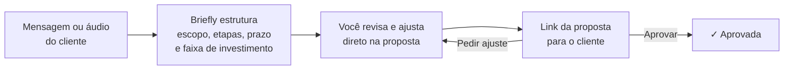
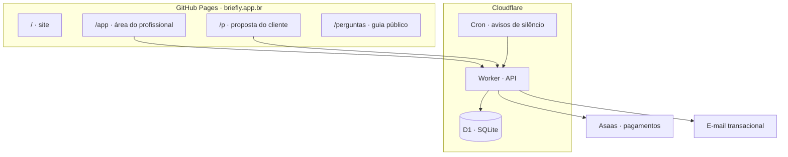

<div align="center">


# Briefly

**Do briefing bagunçado à proposta pronta.**

O cliente manda a ideia do jeito que dá: texto solto no WhatsApp, e-mail, direct ou áudio de 4 minutos.<br>
O Briefly organiza, monta a proposta e entrega um link que o cliente aprova com um toque.

[**briefly.app.br**](https://briefly.app.br) · [Testar grátis](https://briefly.app.br/app/) · [O que perguntar antes do valor](https://briefly.app.br/perguntas/)

`5 propostas grátis` · `sem cartão` · `feito para o mercado brasileiro`

</div>

---

## O problema

Quem vive de projeto (designers, devs, fotógrafos, videomakers, produtores de eventos) perde horas entre a primeira mensagem e o orçamento enviado:

1. decifrar o que o cliente realmente quer;
2. definir escopo, etapas e prazo;
3. chegar num preço que se sustente;
4. diagramar, exportar e revisar;
5. e depois cobrar resposta de um PDF que ninguém abriu.

O trabalho difícil não é deixar o arquivo bonito. É transformar um pedido raso ("é só um site simples") em decisões claras **antes** de falar de dinheiro.

## Como funciona



| Etapa | O que acontece |
|---|---|
| **1. Cole ou grave** | Texto bruto de qualquer canal ou o áudio (inclusive `.opus` do WhatsApp). O áudio é transcrito e não fica armazenado. |
| **2. Estrutura** | Resumo, escopo, o que **não** está incluído, etapas com prazo, investimento com parcelamento e as perguntas que ainda faltam fazer ao cliente. |
| **3. Revise** | Tudo é editável na própria tela. Mudou o valor final? Os itens do investimento se reajustam sozinhos, proporcionalmente. |
| **4. Envie o link** | O cliente abre no celular, vê a validade da proposta e escolhe **Aprovar** ou **Pedir ajuste**. |
| **5. Feche** | Pedido de ajuste chega por e-mail; você atualiza **no mesmo link** e avisa o cliente pelo WhatsApp com uma mensagem pronta. |

## Recursos

**Antes de enviar**
- Leitura de texto e áudio, com vocabulário que muda conforme a área (sites, identidade visual, foto, vídeo, eventos, social media, arquitetura).
- Sugestões calibradas por senioridade (júnior, pleno, sênior). A palavra final no preço é sempre do profissional.
- Caixa **"Antes de passar o valor, pergunte"**: perguntas de fechamento (faixa de investimento, quem decide) com mensagem pronta para copiar, sem preço.
- PDF premium com a logo do profissional.

**Depois de enviar**
- **Link da proposta** com página otimizada para celular, prévia bonita no WhatsApp e data de validade (7, 15 ou 30 dias).
- **Aprovar / Pedir ajuste / Recusar** direto no link.
- **Ajuste no mesmo link**: o cliente sempre vê a versão mais recente.
- **Aviso de silêncio**: se o cliente visualizou e não respondeu em alguns dias, o profissional recebe um e-mail com uma mensagem de retomada pronta.
- Histórico de propostas e painel de números.

## Planos

Créditos avulsos, sem mensalidade e sem cobrança automática. Um crédito = uma proposta.

| Plano | Preço | Créditos | Destaques |
|---|---|---|---|
| Grátis | R$ 0 | 5 | Briefing estruturado, áudio de até 1 min, links de proposta |
| Starter | R$ 9,90 | 15 | Recursos premium, PDF com logo |
| Pro | R$ 29,90 | 50 | Áudio de até 5 min, PDF de até 7 páginas, histórico e painel |
| Business | R$ 59,90 | 150 | Menor custo por proposta, para agências e estúdios |

Pagamento único via Asaas (Pix, cartão ou boleto). Créditos válidos por 12 meses e acumulam.

## Arquitetura

Sem framework e sem servidor para manter: páginas estáticas leves e uma API serverless na borda.



| Camada | Tecnologia |
|---|---|
| Front-end | HTML, CSS e JavaScript puros, cada página em um único arquivo |
| API | Cloudflare Workers |
| Banco | Cloudflare D1 (SQLite) |
| Pagamentos | Asaas (Pix, cartão e boleto) com webhook |
| Hospedagem | GitHub Pages + domínio próprio |
| Deploy | GitHub Actions (site e API publicam sozinhos a cada push) |

## Segurança

O produto nasceu pequeno, mas foi protegido antes de crescer:

- **Limites de uso** por IP e por conta nas rotas sensíveis (login, recuperação de código, geração, transcrição e ações do cliente).
- **Créditos com reserva**: cada geração reserva um crédito e só debita se der certo; falhou, devolve.
- **Pagamento verificado na fonte**: o webhook nunca credita direto, sempre confirma o pagamento na API do Asaas antes.
- **Recuperação de acesso por e-mail**: o código nunca aparece na tela.
- **Erros genéricos** para quem está de fora e **segredos só no cofre** do Cloudflare e do GitHub, nunca no código.

## Estrutura do repositório

```
index.html              Site de apresentação
app/                    Área do profissional (gerar, editar, enviar link)
p/                      Página da proposta que o cliente abre
perguntas/              Guia público "o que perguntar antes do valor"
admin/                  Painel interno (protegido)
worker/
  briefly-worker.js     API: contas, créditos, geração, links, pagamentos, avisos
  wrangler.jsonc        Configuração do Worker e do banco D1
.github/workflows/
  publicar-worker.yml   Publica a API no Cloudflare quando worker/ muda
  publicar-zip.yml      Publica um .zip enviado (atalho para atualizar pelo celular)
termos.html             Termos de uso e privacidade
```

## Rodar localmente

```bash
# site e páginas
python3 -m http.server 8000
# abra http://localhost:8000

# API (precisa do wrangler e dos segredos configurados na sua conta Cloudflare)
cd worker && npx wrangler dev
```

## Por trás

O Briefly é um projeto de **[Joander Santos](https://joandersantos.com.br)**, product designer que desenha e constrói sistemas que tiram trabalho manual do caminho. Nasceu de uma dor própria: horas perdidas entre o "oi, quanto fica?" e uma proposta que o cliente realmente lê.

Tem um projeto parecido em mente? [Fale comigo pelo site](https://joandersantos.com.br).

<div align="center"><sub>© Briefly · 2026 · Um projeto Joander Santos</sub></div>
